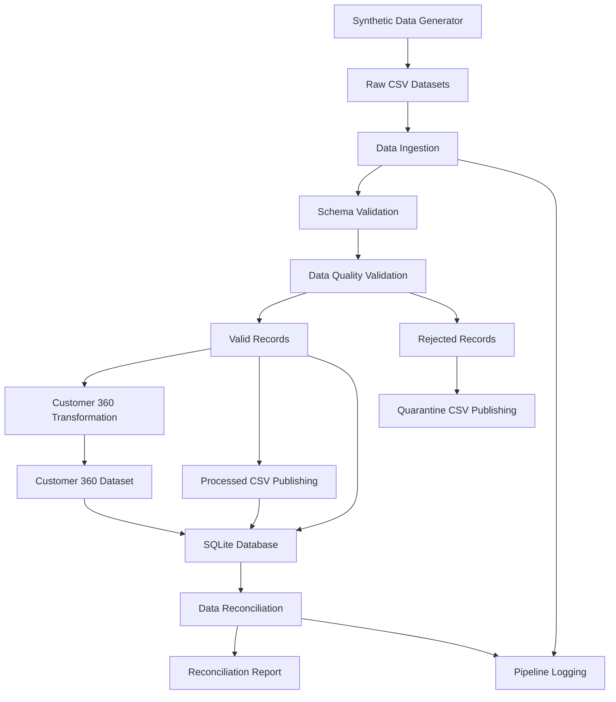

# Customer 360 Data Engineering Architecture

## Pipeline Components

1. **Data Generation:** Creates synthetic customer, account, order and interaction records.
2. **Data Ingestion:** Loads source CSV files.
3. **Schema Validation:** Checks expected columns and schema consistency.
4. **Data Quality Validation:** Checks missing values, duplicates, foreign keys, dates and business rules.
5. **Data Publishing:** Separates valid and rejected records.
6. **Customer 360 Transformation:** Combines customer information with account, order and interaction summaries.
7. **SQLite Storage:** Stores the five resulting database tables.
8. **Reconciliation:** Verifies record counts, financial totals, relationships and aggregations.
9. **Logging:** Records pipeline execution details and failures.