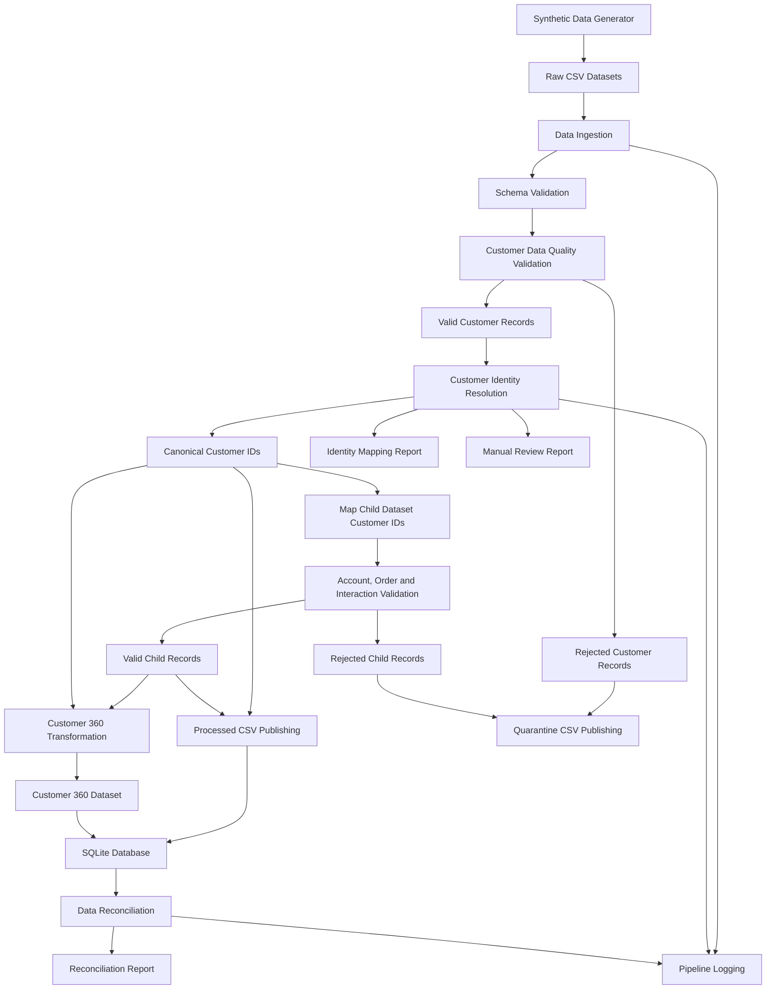

# Customer 360 Data Engineering Architecture

## Architecture Flow

## Pipeline Components

1. **Data Generation:** Creates synthetic customer, account, order and interaction records.

2. **Data Ingestion:** Loads source CSV files into the pipeline.

3. **Schema Validation:** Checks expected columns and schema consistency.

4. **Customer Data Quality Validation:** Checks missing values, duplicate primary keys and customer-level data quality rules.

5. **Customer Identity Resolution:** Normalizes email addresses and phone numbers, automatically matches records with both identifiers matching, and flags uncertain matches for manual review.

6. **Canonical ID Mapping:** Selects a deterministic canonical customer ID and maps related account, order and interaction records to it.

7. **Child Dataset Validation:** Validates foreign keys, dates, duplicate identifiers and business rules for accounts, orders and interactions.

8. **Data Publishing:** Publishes valid datasets and separates rejected records into quarantine CSV files.

9. **Customer 360 Transformation:** Combines customer information with account, order and interaction summaries.

10. **SQLite Storage:** Stores the five resulting database tables.

11. **Reconciliation:** Verifies record counts, financial totals, relationships and customer-level aggregations.

12. **Logging and Monitoring:** Records pipeline execution details, processing metrics and failures.

## Identity Resolution Outputs

- `outputs/customer_identity_mapping.csv` - maps original customer IDs to canonical customer IDs.
- `outputs/identity_manual_review.csv` - records uncertain customer identity matches requiring manual review.

## Key Design Principles

- Deterministic customer identity resolution.
- Referential integrity across related datasets.
- Reproducible processing using deterministic run IDs.
- Traceable rejected records.
- Repeatable pipeline execution.
- Automated testing and reconciliation.
- Vectorized data validation for improved performance.
